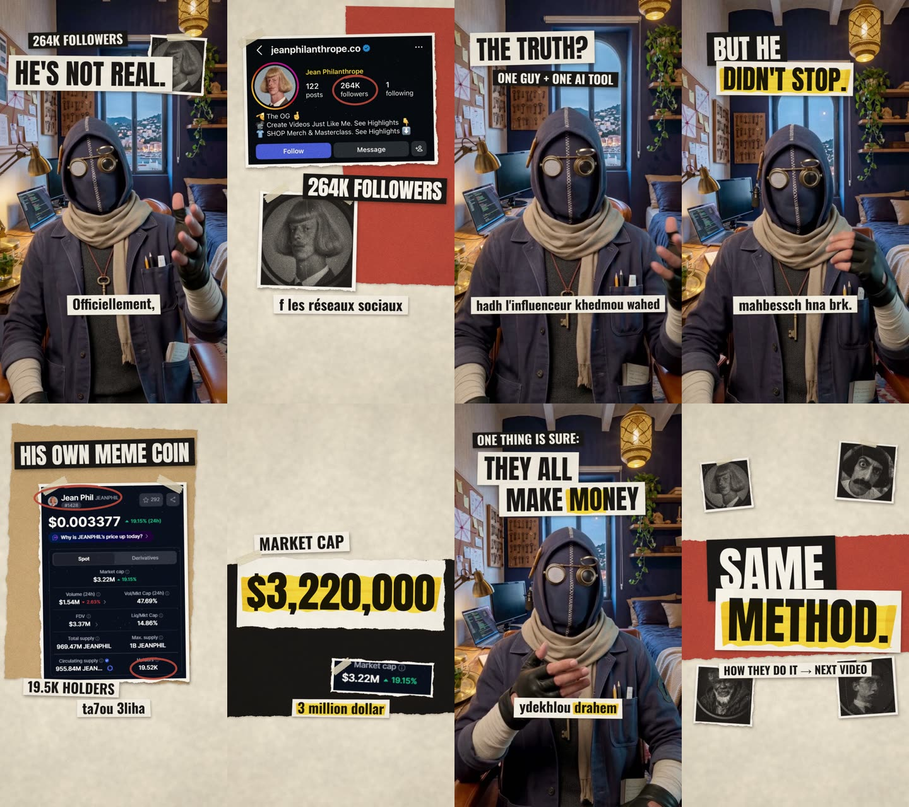

# Masked Host Video Kit

Make short videos where a **masked character speaks your script instead of you**, with graphics, captions and sound added automatically. You never show your face.



## What you get

A 30 to 60 second vertical video (TikTok, Reels, Shorts):

- Your **own voice and your own performance**, on a character you designed
- The character sits in his own room, looking at the camera
- Cutaway graphics (screenshots, numbers, headlines) in a paper-collage style
- Captions, transitions and a few sound effects
- Done by Claude from your clips. You approve one storyboard

## The 4 steps

| Step | What you do | Tool | Time |
|---|---|---|---|
| **1. Character** | Make a masked character and its reference sheet | Higgsfield (Nano Banana Pro) | about 15 min |
| **2. Room** | Make his room and a multi-angle room sheet | Higgsfield (Nano Banana Pro) | 10 min |
| **3. Record and transfer** | Film yourself, then swap yourself for the character | Phone + Higgsfield (Genjutsu motion transfer) | 30 min |
| **4. Edit** | Claude builds the video from your clips and a style brief | Claude Code + Opus 5.5 | You review a storyboard, then about 8 min of rendering |

## Do this

1. **[Step 1: character](1-character/1-character-sheet-prompt.md).** Pick 7 details that say something about you, fill the template, generate.
2. **[Step 2: room](2-room/1-room-prompt.md).** Same idea for the room, then the room sheet.
3. **[Step 3a: record yourself](3-record-and-transfer/1-how-to-record.md).** Short clips, hands in frame, eyes on the lens.
4. **[Step 3b: motion transfer](3-record-and-transfer/2-motion-transfer-prompt.md).** Upload your clip, character, room and room sheet. Same prompt for every clip.
5. **[Step 4: edit with Claude](4-edit-with-claude/1-master-prompt.md).** Paste one prompt. Approve the storyboard. Get the MP4.

Want to see finished prompts first? Open the **[worked example](examples/moftah-example.md)**.

## What you need

| Need | Notes |
|---|---|
| A **Higgsfield** account | For image generation and motion transfer. Check its current plans and credit costs |
| **Claude Code** with **Claude Opus 5.5** | Desktop app or terminal |
| **Node.js 20+**, **ffmpeg**, **Google Chrome** | Free. The edit renders frames in Chrome |
| **Python 3.11** (optional) | For the timing tool `transcribe.py` |
| A phone | For recording |

## What is in the folder

```
masked-host-video-kit/
├── 1-character/        character prompt and reference sheet
├── 2-room/             room prompt and room sheet
├── 3-record-and-transfer/
│                       recording guide and the motion transfer prompt
├── 4-edit-with-claude/
│   ├── 1-master-prompt.md        the one prompt you paste into Claude
│   ├── 2-style-editorial-collage.md   the video style
│   ├── 3-edit-rules.md           cuts, captions, sound and checks
│   └── tools/                    render.mjs, transcribe.py, check_sync.py
└── examples/           a complete worked example with images
```

## Before you post (30 seconds)

- [ ] The first frame already shows the claim as text
- [ ] You watched it once on your phone, with and without sound
- [ ] Every number and screenshot is real and labeled
- [ ] Nothing important is in the top or bottom 10% of the screen (the app covers it)
- [ ] There is a clear takeaway at the end

## Common problems

| Problem | Fix |
|---|---|
| The character has a mouth | Use the stricter `SPEAKING` paragraph in [step 3b](3-record-and-transfer/2-motion-transfer-prompt.md) |
| It looks like a 3D game character | Keep the `LOOK` paragraph in the motion transfer prompt. It asks for live-action footage |
| The character looks down | Record with the script next to the lens |
| Clips do not match each other | Use the **identical** prompt and files for every clip |
| The output is shorter than your recording | Trim your clip to a whole number of seconds first, or cover the gap with graphics |
| Captions are misspelled | Captions come from your script. Transcription is only used for timing |

## Notes

- Higgsfield and Claude change their tools and model names often. The method stays the same: describe a character, copy your movement onto it, and let Claude build the edit.
- Real people and brands shown in your video must be shown accurately. Use real screenshots and real numbers.
- TikTok and Instagram ask you to label AI-generated content. Turn the label on when you post.
