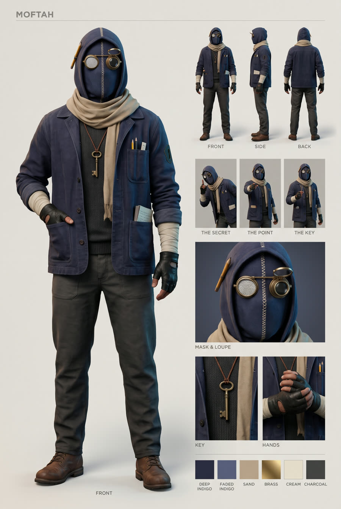
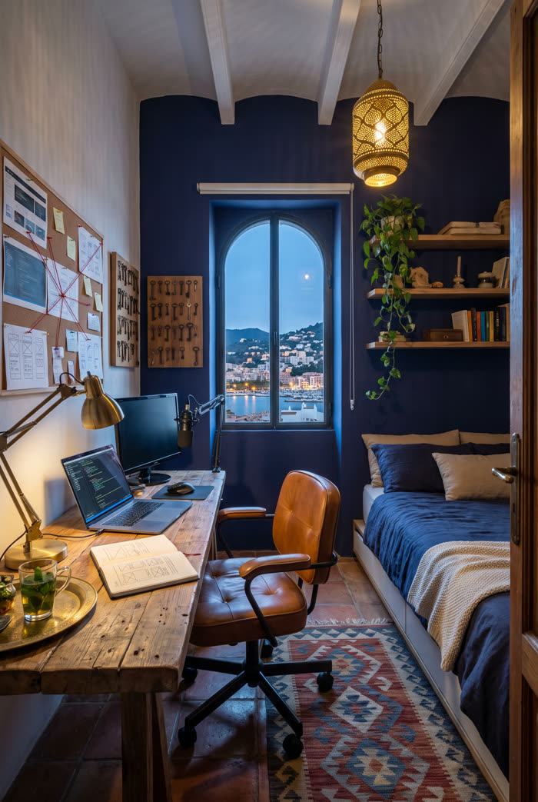
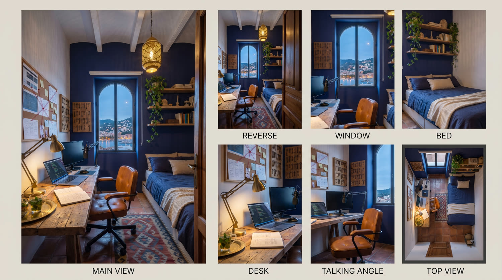

# Worked example: MOFTAH

The character and room used for the example video. Compare these filled-in prompts with the templates to see how the brackets turn into real details.


## How the character was designed

The character is built from the creator's own story, so it does not look like anyone else's.

| About the creator | Becomes this on the character or in the room |
|---|---|
| "I find what is hidden and hand it to you" | A brass jeweler's loupe on the mask. A corkboard with red string in the room |
| Mission: free access to tools | A brass skeleton key on a cord (teeth shaped like a code symbol). A wall of old keys. The name MOFTAH, "the key" |
| Self-taught builder | A hand-stitched mask with a visible seam and patches. Worn workwear |
| Designer, studied literature | A pencil in the hood, a sketchbook, old books on the shelf |
| From Algiers (subtle, no flags) | A sand scarf, a perforated brass lantern, a kilim rug, a tea glass, a harbor view |
| Look: "warm and cold at once, soft, mysterious, timeless" | Cold indigo and moonlight against warm brass and lamplight. No neon |

## The character sheet



The filled-in prompt (step 1):

```
Professional character design reference sheet of an original masked vigilante named MOFTAH, photorealistic cinematic 3D render, warm light-grey paper background, clean editorial layout with small grey uppercase labels.

CHARACTER: A lean, athletic man of average height, real human proportions, not a bodybuilder. He wears a hand-made full-head hood mask of deep indigo-dyed canvas, slightly faded and worn, covering the whole head and face with no mouth, nose or hair visible. A visible hand-stitched seam of cream thread runs from the forehead down the center of the face to the chin, and there are two small stitched repair patches near the jaw. He has two large almond-shaped white mesh eye lenses framed by thin brushed-brass rims, with calm, slightly hooded, knowing eye shapes. A small brass jeweler's loupe on a hinged arm is attached to the right side of the mask, flipped up above the right eye. A short flat carpenter's pencil is tucked into the hood above the left ear.

A long sand-colored cotton desert scarf is loosely wrapped twice around his neck, with frayed ends draped over the left shoulder. An antique brass skeleton key hangs on a dark leather cord at his chest, its teeth shaped like the code symbol </>. He wears a worn dark-indigo workwear chore jacket, faded at the seams, with the sleeves pushed up to the forearms. The chest pocket holds two pencils and a folded paper note, and a small notebook peeks out of a lower pocket. Under the jacket is a charcoal knit crew-neck sweater. He wears worn black fingerless leather gloves, his forearms are wrapped in cream cloth tape, and he has dark charcoal utility trousers and worn brown leather work boots.

LAYOUT: Left half: one large full-body front view, standing relaxed and confident, one hand in his jacket pocket, labeled "FRONT". Top right: three small full-body turnaround views labeled "FRONT", "SIDE", "BACK". Middle right: three pose thumbnails labeled "THE SECRET", "THE POINT", and "THE KEY". Bottom right: three close-up detail panels labeled "MASK & LOUPE", "KEY", "HANDS", then a row of color swatches (deep indigo, faded indigo, sand, brass, cream, charcoal).

Mood: warm and cold at once, quietly mysterious, timeless. Soft directional light, a cool blue fill and a warm brass key light. Realistic fabric texture, visible stitching and wear. The design is identical in every view. 8k, sharp focus, no extra text beyond the labels.
```

## The room and the room sheet




The filled-in room prompt (step 2, image A):

```
Photorealistic interior photo of a self-taught builder's bedroom-workshop, a rooftop room in an old whitewashed Mediterranean building, at blue hour turning to night. Shot from the doorway at standing eye level with a wide 24mm lens. The room is empty, with no people.

LAYOUT: Back wall center: a tall arched window with thin dark wooden frames, open shutters, and a view of a hillside city at blue hour with warm window lights cascading down to a bay and a harbor. Left wall: a thick reclaimed-wood desk holding an open laptop with lines of code, a second slim monitor, a black microphone on a boom arm, a brass articulated drafting lamp, an open sketchbook with hand-drawn interface wireframes, and a small brass tray with a glass of mint tea. A worn cognac-leather swivel chair stands at the desk. Above the desk is a large corkboard covered with printed screenshots, sketches, sticky notes and index cards, connected by red string and pins like an investigator's board. Next to the corkboard, a wooden board holds dozens of antique keys of different sizes hanging on small brass hooks. Right side: a low platform bed with deep-indigo linen bedding, sand-colored pillows and a cream chunky-knit throw. Above the bed, floating wooden shelves hold old literature hardcovers and worn paperbacks, a few handmade objects and a trailing plant. Floor: aged terracotta tiles under a woven kilim rug with a geometric pattern in indigo, sand and rust. Walls: warm limewashed white plaster, with the window wall painted deep indigo. A perforated brass lantern hangs from the wooden-beamed ceiling and casts soft star-patterned light and shadow across the walls.

LIGHTING: Warm and cold at once. The warm amber light comes from the drafting lamp and the brass lantern. The cool blue moonlight comes in through the arched window. Soft haze, gentle falloff, airy and calm, quietly mysterious, timeless. No neon, no RGB LEDs, no gaming setup.

Photorealistic, cinematic architectural interior photography, film grain, 8k, sharp focus, no text, no logos, no flags.
```

The room sheet prompt is used exactly as written in the template, with `@image_1` = the room.

## The motion transfer prompt (step 3)

Model: Higgsfield Genjutsu at 1080p. `@video1` = the clip, `@image1` = character sheet, `@image2` = room, `@image3` = room sheet. The same text was used for both clips.

```
Replace the person in @video1 with the masked man from @image1, seated in his room from @image2, filmed from the camera position shown in the "TALKING ANGLE" panel of @image3. Keep 100% of the body motion, hand gestures, head movement, timing and speed of @video1, frame for frame: same duration, no slow motion, no speed ramp, no added or skipped gestures.

CHARACTER (exactly as @image1, every detail locked): the hood of the hand-stitched deep-indigo canvas mask is up, covering his whole head and face, with the cream zig-zag stitched seam down the center of the face. Brass goggle eyepieces: a round white mesh lens on the viewer's left, and a dark lens with the flip-up brass jeweler's loupe ring on the viewer's right. A carpenter's pencil is tucked in the hood on the viewer's left. A sand-colored scarf is wrapped loosely around his neck. An antique brass skeleton key hangs on a brown leather cord over a charcoal knit sweater, under a worn indigo chore jacket with pencils in the chest pocket. Sleeves are pushed up, cream cloth-taped forearms, black fingerless leather gloves with real skin visible on the fingers. No cap, no white t-shirt, no lavalier microphone.

SPEAKING: he speaks from inside the mask. The mask never opens: no mouth, no lips, no teeth, no mouth shape ever appears. Only the canvas over the jaw shifts very slightly with each sentence, and his chest and shoulders rise and fall with natural breathing, like a real man talking behind thick fabric.

EYE LINE: his head stays level and his eyepieces look straight into the camera lens for the whole clip. When the original performer glances down, keep the head facing the camera and transfer only small natural nods and tilts.

HANDS: anatomically correct, five fingers on each hand, natural speed, real motion blur on fast gestures, and the gloves and the cloth tape keep their shape. When a hand exits the frame it exits naturally, with no warping.

FRAMING: the same 9:16 framing as @video1: seated in the cognac leather swivel chair, chest-up, his head at the same height in the frame as the original performer. The upper part of the frame is room background (the corkboard with red string, the antique key boards, the indigo wall), softly out of focus with shallow depth of field.

LOOK: real live-action footage of a real man in a handmade costume, shot on a cinema camera with a 35mm lens, static locked-off tripod. Warm amber key light from the brass desk lamp side, cool blue moonlight rim from the window, soft haze, natural skin on the fingers, real canvas and leather texture, subtle film grain. Not CGI, not 3D, not animated, not a video game render. The room stays perfectly still, no flicker.
```

## What happened in practice

- Both clips came back with **no mouth**, the head facing the camera, the costume identical across the two clips and the audio at exactly 0 ms offset from the original recordings.
- Both came back **0.9 seconds shorter** than the source (26.9s to 26.0s, 20.9s to 20.0s). We covered the missing ending of each clip with a graphic cutaway. The tip in step 3a (trim to whole seconds first) avoids this.
- Higgsfield exported 720p. The video was rendered at 1080p by scaling the clips up, which still looks sharp on a phone.
- The edit is 49 seconds with 6 talking-head beats and 6 cutaway scenes. The final render took about 8 minutes on a laptop with no GPU.
